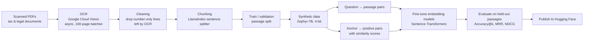

# Fine-Tuning Embedding Models for Retrieval over Scanned Tax Documents

Off-the-shelf embedding models are trained on general web text, so they often miss what matters in specialised documents: tax brackets, legal phrasing, rate thresholds. This project builds a retrieval pipeline for **scanned San Francisco tax and legal documents** and shows that **fine-tuning the embedding model on synthetic, domain-specific data** improves how often the right passage is retrieved.

<p>
  
  
  
  
  
</p>

## Results

Fine-tuning **BGE-small** with Multiple Negatives Ranking Loss on synthetic question–passage pairs, evaluated on a held-out set of 103 questions over 52 unseen passages:

| Metric | Before fine-tuning | After fine-tuning | Change |
|---|---|---|---|
| Accuracy@1 (right passage ranked first) | 59.2% | **64.1%** | +4.9 pts |
| Accuracy@3 | 80.6% | **81.6%** | +1.0 pts |
| Accuracy@10 | 91.3% | **93.2%** | +1.9 pts |
| MRR@10 | 0.711 | **0.735** | +0.024 |
| NDCG@10 | 0.760 | **0.783** | +0.022 |

The biggest gain is at rank 1: the right passage comes first more often, which matters most when only the top few results are passed to an LLM.

## How it works



### 1. OCR of scanned documents

The source PDFs are scanned images, so the text first has to be read. `OCR_of_Scanned_PDF_Using_Google_VIsion_API_and_Preprocessing.ipynb` sends the PDFs from Google Cloud Storage to the **Google Cloud Vision** API asynchronously in 100-page batches, collects the JSON results batch by batch, and removes the number-only lines that the legal documents' line numbering leaves in the OCR output, before saving clean text (`data after preprocessing/`).

### 2. Synthetic training data

There are no labelled questions for these documents, so an LLM generates them. Each passage is given to **Zephyr-7B-beta** (4-bit quantised), which writes:

- **Question → passage pairs**: questions a user might ask that the passage answers (238 training and 103 evaluation questions).
- **Anchor → positive pairs with a similarity score**: two related statements and how similar they are (132 training and 35 evaluation pairs).

Training and evaluation questions come from **different passages**, so the evaluation measures generalisation to unseen text. The dataset is published as [Areeb-02/Q-corpus-sales-tax](https://huggingface.co/datasets/Areeb-02/Q-corpus-sales-tax).

### 3. Comparing training objectives

| Loss | Base model | Data it needs | Outcome |
|---|---|---|---|
| **Multiple Negatives Ranking Loss** | `BAAI/bge-small-en` | Question → passage pairs; other passages in the batch act as negatives | Clear retrieval gains (table above) |
| **CoSENT** and **AnglE** | `BAAI/bge-large-en-v1.5` | Pairs with graded similarity scores | Did not improve similarity correlation on this small set; the LLM-generated scores were likely too noisy |
| **GISTEmbed** | `microsoft/mpnet-base`, guided by `BAAI/bge-base-en-v1.5` | Anchor → positive pairs; a guide model filters false negatives | Trained and published for comparison |

The comparison suggests that, with a few hundred synthetic examples, **contrastive training on question–passage pairs is the most reliable choice**: it needs no similarity labels, so it is not limited by how well the LLM can score similarity.

## Published models

- [Areeb-02/bge-small-en-MultiplrRankingLoss-Tax-dataset](https://huggingface.co/Areeb-02/bge-small-en-MultiplrRankingLoss-Tax-dataset): the best-performing model above
- [Areeb-02/bge-large-en-v1.5-AngleLoss-25-Epochs](https://huggingface.co/Areeb-02/bge-large-en-v1.5-AngleLoss-25-Epochs)
- [Areeb-02/mpnet-base-GISTEmbedLoss-MSEE_Evaluator-salestax-docs](https://huggingface.co/Areeb-02/mpnet-base-GISTEmbedLoss-MSEE_Evaluator-salestax-docs)

Use the fine-tuned model like any Sentence Transformers model:

```python
from sentence_transformers import SentenceTransformer

model = SentenceTransformer("Areeb-02/bge-small-en-MultiplrRankingLoss-Tax-dataset")
query = model.encode("What is the tax rate for gross receipts between $1M and $2.5M?")
passages = model.encode(["...", "..."])
```

## Repository structure

```
├── OCR_of_Scanned_PDF_Using_Google_VIsion_API_and_Preprocessing.ipynb  # OCR + cleaning + chunking
├── Fine_tuning_Embedding_Models.ipynb       # Synthetic data, training with all four losses, evaluation
├── Another_copy_of_Fine_tuning_Embedding_Models.ipynb  # Earlier version of the experiments
├── data/                                    # Source PDFs
├── data after preprocessing/                # OCR output, cleaned text
└── synthetic data/
    ├── qa-embedding pair/                   # Question → passage pairs (train / eval)
    └── anchor-positive-similarity score/    # Scored pairs (train / eval)
```

## Running the notebooks

The notebooks are designed for **Google Colab** (each has an "Open in Colab" badge). The OCR notebook needs a Google Cloud project with the Vision API enabled and a Cloud Storage bucket; the fine-tuning notebook needs a GPU runtime for Zephyr-7B and a Hugging Face token to publish models.

## Author

**Areeb Ahmad Chaudhry**: [website](https://areebahmad-02.github.io) · [Google Scholar](https://scholar.google.com/citations?user=gaDnnFwAAAAJ) · [GitHub](https://github.com/AreebAhmad-02)
